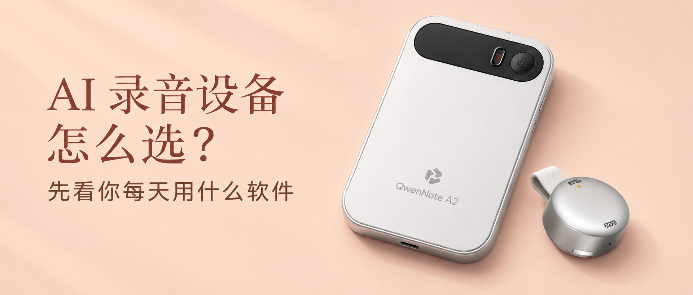

## 文章合集 · 6 篇

**[智能硬件行业知识分享 · 查看目录](https://github.com/youngting520/youngting520.github.io/blob/main/%E6%99%BA%E8%83%BD%E7%A1%AC%E4%BB%B6%E8%A1%8C%E4%B8%9A%E7%9F%A5%E8%AF%86%E5%88%86%E4%BA%AB/README.md)** 
从千问与涂鸦、广和通的合作，到智能玩具的模型选型、成本和采购。

## 最新文章

开会时需要回听原话，还是更想把待办直接发到钉钉？从日常工作里的 7 个问题出发，比较 6 款 AI 录音设备。[阅读全文 →](https://youngting520.github.io/audio-recorder-comparison.html)
